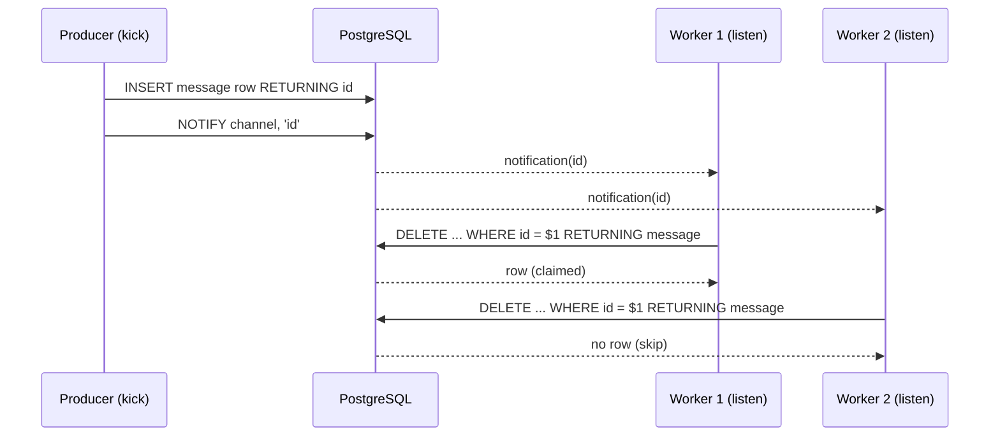

# Architecture

How `taskiq-postgresql` is put together. Decisions and their reasons are in
[`adr/`](adr/); commands and conventions are in [`../AGENTS.md`](../AGENTS.md).

## Components

Three classes implement taskiq's extension points. Each builds its own driver
at construction, so creating one never opens a connection.

| Component | Module | taskiq base | Table (default name) |
|---|---|---|---|
| `PostgresqlBroker` | `taskiq_postgresql/broker.py` | `AsyncBroker` | `taskiq_messages` |
| `PostgresqlResultBackend` | `taskiq_postgresql/result_backend.py` | `AsyncResultBackend` | `taskiq_results` |
| `PostgresqlSchedulerSource` | `taskiq_postgresql/scheduler_source.py` | `ScheduleSource` | `taskiq_schedulers` |

Every component takes a `dsn` (a string, or a callable returning one) and a
`driver` name. The DSN helpers live in `utils/dsn.py`: `require_dsn` rejects
`None`, an empty or blank string, or a value that is neither a string nor a
callable with `TypeError` at construction. A callable is resolved once, by
`startup()` (`resolve_dsn`), which hands the string to every driver of the
component; until then the drivers hold an empty connection string
(`dsn_before_startup`) and refuse to connect. The broker also builds a listen
driver for `LISTEN`.

## Driver abstraction

`taskiq_postgresql/abc/driver.py` defines the two interfaces:

- `QueryDriver` holds the table definition (primary key, columns,
  `created_at`, index columns) and one builder per statement from
  `abc/query.py`, created in its `__init__`. Drivers implement `insert`,
  `insert_or_update`, `delete`, `delete_returning`, `delete_by_date`,
  `select`, `exists`, `execute`, `on_startup` and `on_shutdown`. Every query
  method enters `async with driver`, which creates the connection pool on
  first use; `on_shutdown` closes it, and does nothing when no query ever
  created it.
- `ListenDriver` owns the connection that listens on the channel (for psqlpy,
  a pool listener). Iterating it (`async for`) yields the ids carried by
  `NOTIFY`.

`utils/get_db_driver.py` and `utils/get_db_listen_driver.py` map the `driver`
name to a class. `drivers/__init__.py` imports a driver module only when
`utils/libs_available.py` finds its library, so a missing extra raises
`ImportError` naming `taskiq-postgresql[<driver>]`, and an unknown name raises
`ValueError`.

### The three drivers

| | asyncpg (`drivers/_asyncpg.py`) | psqlpy (`drivers/_psqlpy.py`) | psycopg (`drivers/_psycopg.py`) |
|---|---|---|---|
| Pool | `asyncpg.create_pool` | `psqlpy.ConnectionPool` | `psycopg_pool.AsyncConnectionPool` with `AsyncRawCursor`, so `$n` placeholders work |
| JSONB values | dict -> JSON text (`pydantic_core.to_json`) | wrapped in `psqlpy.extra_types.JSONB` (JSON text is parsed first) | dict -> JSON text (`pydantic_core.to_json`) |
| UUID values | `UUID` -> hex text | text -> `uuid.UUID` | `UUID` -> hex text |
| Listen | `asyncpg.connect` + `add_listener` callback into a queue | pool `listener()` with a callback into a queue | autocommit connection, `LISTEN <channel>`, then `notifies()`; a payload that is not an integer is logged and skipped |

asyncpg and psycopg shape their bind parameters with the shared
`encode_params` in `drivers/_params.py`; psqlpy has its own
`encode_psqlpy_params`. Both pair columns and values with
`zip(..., strict=True)`, so a count mismatch raises `ValueError` before
anything reaches the server.

## SQL

`taskiq_postgresql/abc/query.py` builds every DDL statement and row query.
Values are always bind parameters (`$1`, `$2`, ...). Table, column and channel
names come from the component's configuration and are written unquoted, so
PostgreSQL folds them to lower case. Two statements are formatted outside the
builders: `LISTEN <channel>` in the psycopg listen driver, and
`NOTIFY <channel>, '<id>'` in the broker, whose payload is the integer id its
own INSERT returned.

### Tables

Created by `on_startup` only when the component gets `run_migrations=True`,
with `CREATE TABLE IF NOT EXISTS` and hash indexes, so an existing table is
never altered. `tests/unit/test_components.py::test_default_schema` pins the
DDL below.

`on_startup` migrates on one connection, in one transaction. It first checks
with `to_regclass` (`RelationsExistQuery`) whether the table and every index
it creates exist; if they do, it returns without a lock or DDL, so a role
with only DML privileges can start. Otherwise it takes
`pg_advisory_xact_lock(hashtext('taskiq_postgresql'), hashtext(<table name>))`
(`MigrationLockQuery`) and runs the DDL: a concurrent startup waits for the
commit, and its `IF NOT EXISTS` then finds the objects. The lock key stays
the same across releases, so two versions in a rolling deploy also wait for
each other.

| Table | Columns | Hash indexes |
|---|---|---|
| `taskiq_messages` | `id SERIAL` (PK), `task_id` (type from `field_for_task_id`), `task_name VARCHAR`, `message BYTEA`, `labels JSONB`, `created_at` | `id` |
| `taskiq_results` | `task_id` (PK, type from `field_for_task_id`), `result BYTEA`, `created_at` | `task_id` |
| `taskiq_schedulers` | `id UUID` (PK), `task_name VARCHAR(100)`, `schedule JSONB`, `updated_at`, `created_at` | `id`, `task_name` |

All columns are `NOT NULL`; `created_at` and `updated_at` default to `NOW()`.

### Queries by operation

| Operation | Builder | SQL shape |
|---|---|---|
| `PostgresqlBroker.kick` | `InsertQuery` | `INSERT ... VALUES ($1, ...) RETURNING id`, then `NOTIFY` |
| `PostgresqlBroker.listen` | `DeleteReturningQuery` | `DELETE FROM ... WHERE id = $1 RETURNING message` |
| `PostgresqlResultBackend.set_result` | `InsertOrUpdateQuery` | `INSERT ... ON CONFLICT (task_id) DO UPDATE SET result = EXCLUDED.result` |
| `is_result_ready` | `SelectQuery` | `SELECT 1 FROM ... WHERE task_id = $1` |
| `get_result` | `SelectQuery`, then `DeleteQuery` unless `keep_results` | `SELECT result ... WHERE task_id = $1` |
| `delete_by_date` | `DeleteByDateQuery` | `DELETE ... WHERE created_at BETWEEN $1 AND $2` |
| `PostgresqlSchedulerSource.get_schedules` | `SelectQuery` | `SELECT schedule FROM ...` |
| `add_schedule` | `InsertQuery` | `INSERT (id, task_name, schedule) ...` |
| `delete_schedule`, `post_send` (one-off schedules) | `DeleteQuery` | `DELETE ... WHERE id = $1` |

## LISTEN/NOTIFY flow

1. `kick` inserts the message and sends `NOTIFY` with the new row id. With a
   `delay` label, the `NOTIFY` is scheduled on the producer's event loop
   (`loop.call_at`), so it is only sent if that process is still running.
2. Every listening worker receives the id; its listen driver yields it as an
   `int`.
3. Each worker runs `DELETE ... RETURNING`; PostgreSQL gives the row to one of
   them, and the others get no row and move on. The message is yielded as an
   `AckableMessage` whose `ack` is a no-op, because the row is already gone.

## Error handling

`taskiq_postgresql/exceptions.py` defines `DatabaseConnectionError` and
`ResultIsMissingError`, both subclasses of `BaseTaskiqAsyncpgError`.

- `DatabaseConnectionError`:
  - every `ListenDriver.on_startup` raises it when the `LISTEN` connection
    cannot start, so `PostgresqlBroker.startup()` fails with it;
  - asyncpg raises it when the pool cannot be created;
  - psqlpy and psycopg raise it for any error while a pooled connection is
    held, query errors included, because their `connection()` context wraps
    the whole block;
  - every driver raises it from `connection()` when called outside
    `async with driver`, before any pool exists;
  - a component built with a callable DSN raises it when used before
    `startup()`, since its drivers have no connection string yet.
- `ResultIsMissingError`: `get_result` finds no row for the task id.
- `TypeError`: a component is built without a usable DSN, or its DSN
  callable returns no usable DSN at `startup()`.
- `ValueError`: an unknown driver name, a column/value count mismatch, or an
  upsert without update columns.
- `PostgresqlBroker.listen` logs any other exception and keeps listening.
