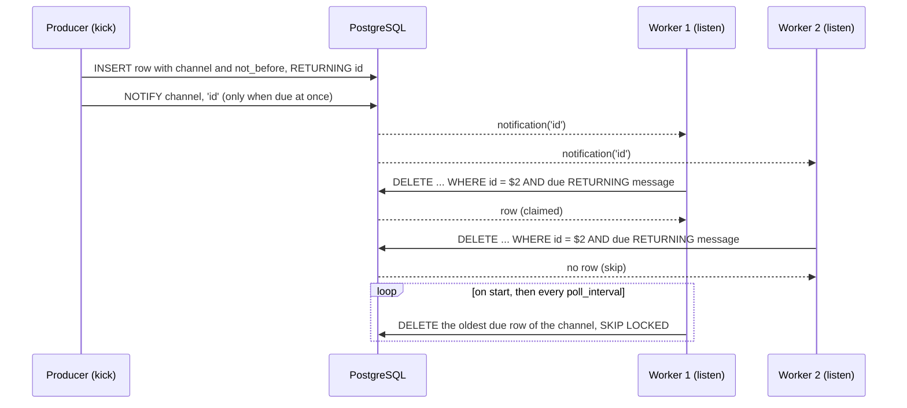

# Architecture

How `taskiq-postgresql` is put together. Decisions and their reasons are in
[`adr/`](adr/); commands and conventions are in [`../AGENTS.md`](../AGENTS.md).

## Components

Three classes implement taskiq's extension points. Each builds its own driver
at construction, so creating one never opens a connection.

| Component | Module | taskiq base | Table (default name) |
|---|---|---|---|
| `PostgresqlBroker` | `taskiq_postgresql/broker.py` | `AsyncBroker` | `taskiq_messages` |
| `PostgresqlResultBackend` | `taskiq_postgresql/result_backend.py` | `AsyncResultBackend` | `taskiq_results` |
| `PostgresqlSchedulerSource` | `taskiq_postgresql/scheduler_source.py` | `ScheduleSource` | `taskiq_schedulers` |

Every component takes a `dsn` (a string, or a callable returning one) and a
`driver` name. The DSN helpers live in `utils/dsn.py`: `require_dsn` rejects
`None`, an empty or blank string, or a value that is neither a string nor a
callable with `TypeError` at construction. A callable is resolved once, by
`startup()` (`resolve_dsn`), which hands the string to every driver of the
component; until then the drivers hold an empty connection string
(`dsn_before_startup`) and refuse to connect. The broker also builds a listen
driver for `LISTEN`.

## Driver abstraction

`taskiq_postgresql/abc/driver.py` defines the two interfaces:

- `QueryDriver` holds the table definition (primary key, columns,
  `created_at`, index columns, and the `added_columns` and `added_indexes`
  that `on_startup` adds to a table that may already exist) and one builder
  per statement from `abc/query.py`, created in its `__init__`. Drivers
  implement `insert`, `insert_or_update`, `delete`, `fetch_row`,
  `delete_by_date`, `select`, `exists`, `execute`, `on_startup` and
  `on_shutdown`. `fetch_row(query, *values)` runs a query its caller built
  and returns the first row as a `dict`, or `None`; the broker runs its claims
  through it. Every query method enters `async with driver`, which creates the
  connection pool on first use; `on_shutdown` closes it, and does nothing when
  no query ever created it or a previous call closed it. The `query_timeout`
  attribute (seconds; `None`, the default, waits for as long as it takes) is
  set by the broker on its own driver. asyncpg and psycopg bound `fetch_row`
  and `on_shutdown` by it, and `fetch_row` raises `asyncio.TimeoutError` when
  it runs out. psqlpy does not bound its claims, since it can neither cancel
  a query on the server nor drop one pooled connection; its close returns at
  once.
- `ListenDriver` owns the connection that listens on the channel (for psqlpy,
  a pool listener). Iterating it (`async for`) yields the payload of each
  `NOTIFY` unparsed, as the `str` the server sent, and ends or raises when
  the connection is lost. The broker reopens a lost connection by calling
  `on_shutdown()` and then `on_startup()`, so both must work any number of
  times. The broker also sets its `health_check_interval` and `query_timeout`
  attributes (`None` by default: no check, no bound). The bundled drivers
  then check a connection that stayed silent for `health_check_interval`
  seconds (psycopg: every `health_check_interval` seconds) by sending the same
  `LISTEN` again (`check_listen` in `drivers/_health.py`); with no answer
  within `query_timeout`, they close the connection and the iterator raises
  `DatabaseConnectionError`.

`utils/get_db_driver.py` and `utils/get_db_listen_driver.py` map the `driver`
name to a class. `drivers/__init__.py` imports a driver module only when
`utils/libs_available.py` finds its library, so a missing extra raises
`ImportError` naming `taskiq-postgresql[<driver>]`, and an unknown name raises
`ValueError`.

### The three drivers

| | asyncpg (`drivers/_asyncpg.py`) | psqlpy (`drivers/_psqlpy.py`) | psycopg (`drivers/_psycopg.py`) |
|---|---|---|---|
| Pool | `asyncpg.create_pool` | `psqlpy.ConnectionPool` | `psycopg_pool.AsyncConnectionPool` with `AsyncRawCursor`, so `$n` placeholders work |
| JSONB values | dict -> JSON text (`pydantic_core.to_json`) | wrapped in `psqlpy.extra_types.JSONB` (JSON text is parsed first) | dict -> JSON text (`pydantic_core.to_json`) |
| UUID values | `UUID` -> hex text | text -> `uuid.UUID` | `UUID` -> hex text |
| Listen | `asyncpg.connect` + `add_listener` callback into a queue; a termination listener ends the iteration when the connection closes | pool `listener()`; `add_callback` with a no-op registers the channel, `LISTEN <channel>` on the listener's connection subscribes before `on_startup()` returns (psqlpy sends its own only on the first read), and a task iterates the listener into a queue, then queues the error that ended it | autocommit connection, `LISTEN <channel>`, then `notifies(timeout=health_check_interval)` in rounds, with no notify handler |
| Bounded waits (`query_timeout`) | `pool.acquire(timeout=...)`, `fetchrow(timeout=...)`; a close that runs out aborts the connections (`terminate()`) | the startup `LISTEN`, the LISTEN health check and its close only | `_answered_within` shuts the socket down and closes the connection when a query runs out; `pool.close(timeout=...)` |

The broker is the only place a payload is parsed: `_read_notified_ids` in
`broker.py` reads the message id with `_parse_message_id`. A payload that is
not an integer from 1 to 2147483647, the range of the broker's `id` column,
is logged, cut to its first 64 characters (`_payload_excerpt`) because any
role that can connect can notify the channel, and skipped.

asyncpg and psycopg shape their bind parameters with the shared
`encode_params` in `drivers/_params.py`; psqlpy has its own
`encode_psqlpy_params`. Both pair columns and values with
`zip(..., strict=True)`, so a count mismatch raises `ValueError` before
anything reaches the server.

## SQL

`taskiq_postgresql/abc/query.py` builds every DDL statement and row query.
Values are always bind parameters (`$1`, `$2`, ...). Table and column names
come from the component's configuration and are written unquoted, so
PostgreSQL folds them to lower case. Channel names are not handled the same by
every driver (measured with `log_statement=all`): the broker sends
`NOTIFY <channel>, '<id>'` unquoted, which folds the name; psycopg and psqlpy
send `LISTEN <channel>` unquoted too, but asyncpg's `add_listener` sends
`LISTEN "<channel>"` quoted, which keeps the case. With a channel name that
has upper case letters, an asyncpg worker therefore gets no `NOTIFY`: the
message waits for the next sweep, which compares the stored channel as is and
delivers it within `poll_interval` seconds. psqlpy and psycopg workers get
the `NOTIFY`. Use a lower-case `channel_name`, so that every driver delivers
at once.

Two statements are formatted outside the builders: `LISTEN` in the listen
drivers (the `LISTEN <channel>` with which psycopg and psqlpy subscribe, and
in all three the health check, which repeats the statement that registered
the channel, quoting included), and `NOTIFY <channel>, '<id>'` in the broker, whose
payload is the integer id its own INSERT returned.

### Tables

Created by `on_startup` only when the component gets `run_migrations=True`,
with `CREATE TABLE IF NOT EXISTS` and hash indexes. The broker's table then
gets its `channel` and `not_before` columns and a btree index on them from
`AddColumnsQuery` (`ALTER TABLE ... ADD COLUMN IF NOT EXISTS`, then
`CREATE INDEX IF NOT EXISTS`), so a table created by 0.4.x ends up with the
same columns as a new one. The DDL is additive only: no column is ever
changed or dropped. `tests/unit/test_components.py::test_default_schema` pins
the `CREATE TABLE` and hash index DDL below, and
`tests/test_migrations.py::test_add_claim_columns_query_is_the_upgrade_sql`
the added columns and their index.

`on_startup` migrates on one connection, in one transaction. It first checks
with `to_regclass` (`RelationsExistQuery`) whether the table and every index
it creates exist, and with `pg_attribute` whether the table has the added
columns; if they all do, it returns without a lock or DDL, so a role with only
DML privileges can start. Otherwise it takes
`pg_advisory_xact_lock(hashtext('taskiq_postgresql'), hashtext(<table name>))`
(`MigrationLockQuery`) and runs the DDL in that transaction: `CREATE TABLE`,
the hash indexes, then the added columns and their index, before the commit.
A concurrent startup waits for the commit, and its `IF NOT EXISTS` then finds
the objects. The lock key stays the same across releases, so two versions in a
rolling deploy also wait for each other.

`taskiq_postgresql/migrations.py` describes each table twice, from the same
builders: as columns and indexes (`TableSchema`), and as the ordered
statements `on_startup` runs (`MigrationStep`: step 1 is `CREATE TABLE` and
its indexes; step 2, on the broker's table only, the added columns and their
index). `taskiq postgresql
generate` (`cli.py`) renders the steps as a script for another migration tool,
with the same advisory lock and, by default, a `SET LOCAL lock_timeout` first,
so that a run against a live database fails instead of queueing behind open
transactions. `taskiq postgresql migrate` runs the migration of
`run_migrations=True` once. `tests/test_migration_script.py` checks that the
steps are the statements the drivers build for `on_startup` and that the
script builds the catalog `on_startup` builds.

The same module compares a database with that description. Each step also
names what it creates (`MigrationStep.objects`, a `StepObjects`: whether it
creates the table, its columns, its indexes). `catalog_query` is one read-only
`SELECT` with the names written in as literals, so every driver runs it as it
is; it resolves each table and index name with `to_regclass` and returns, as
one JSON text value, the relation's kind and columns (`pg_attribute`, with
`format_type`) and, per index name, whether it is an index of that table,
`indisvalid`, its access method, columns, uniqueness and predicate.
`CatalogState.from_json` reads it, and `plan_migration` compares it with the
steps: a step whose table, column or index is absent is pending (`required`
when the table or a column is missing, `advisory` when only an index is), and
since every statement is `IF NOT EXISTS`, running the whole step again
completes it. What `IF NOT EXISTS` would skip becomes a `SchemaProblem`
instead, never DDL: a name another relation took, an index on another table,
an invalid index, an index of another shape, a column of another type, or a
missing column that only a step's `CREATE TABLE` creates, which skips a table
that exists. A released step never changes; `tests/golden/migration_steps.sql`
pins them.

`contrib/alembic.py` puts that engine into Alembic's autogenerate. Importing it
registers `compare_taskiq_steps` as a schema comparator that runs after
Alembic's own. It finds the descriptions `taskiq_metadata` and
`add_taskiq_tables` (`contrib/sqlalchemy.py`) leave in `MetaData.info`, runs
`catalog_query` on autogenerate's connection, and calls `plan_migration`. It
removes the `create_table`, `add_column` and `create_index` operations Alembic
proposed for objects of the pending steps, keeps every other operation (a type
change still shows), and adds one `TaskiqStepOp` per pending step; problems
become warnings in the log. A `TaskiqStepOp` renders as `op.execute(...)`
calls holding the step's SQL, so a revision runs the statements
`run_migrations=True` runs without importing the package; its downgrade does
nothing, the DDL being additive. Unless configured to `0`, each step sets its
own `lock_timeout` (`SET LOCAL`) before it takes the same advisory lock, and
ends by giving
Alembic's transaction back the `lock_timeout` it had, so the user's own
migrations in that transaction keep theirs. `upgrade_taskiq_tables` runs the same steps, up to a given step
number, from a hand-written revision, and `alembic check` fails while a step
is missing because `TaskiqStepOp` is an upgrade operation.

| Table | Columns | Indexes |
|---|---|---|
| `taskiq_messages` | `id SERIAL` (PK), `task_id` (type from `field_for_task_id`), `task_name VARCHAR`, `message BYTEA`, `labels JSONB`, `created_at`; added: `channel VARCHAR`, `not_before TIMESTAMP WITH TIME ZONE` | hash on `id`; added: btree `taskiq_messages_not_before_idx` on `(channel, not_before, id)` |
| `taskiq_results` | `task_id` (PK, type from `field_for_task_id`), `result BYTEA`, `created_at` | hash on `task_id` |
| `taskiq_schedulers` | `id UUID` (PK), `task_name VARCHAR(100)`, `schedule JSONB`, `updated_at`, `created_at` | hash on `id` and on `task_name` |

All columns but the broker's `channel` are `NOT NULL`; `created_at`,
`updated_at` and `not_before` default to `NOW()`. A row stored by 0.4.x has no
`channel`.

### Queries by operation

| Operation | Builder | SQL shape |
|---|---|---|
| `PostgresqlBroker.kick` | `InsertQuery` | `INSERT ... (..., channel, not_before) VALUES ($1, ..., $5, NOW() + make_interval(secs => $6::double precision)) RETURNING id`, then `NOTIFY` when the message is due at once |
| `PostgresqlBroker.listen`, sweep | `ClaimDueQuery`, run by `fetch_row` | `DELETE FROM ... WHERE id = (SELECT id ... WHERE channel = $1 AND not_before <= NOW() ORDER BY not_before, id LIMIT 1 FOR UPDATE SKIP LOCKED) RETURNING message` |
| `PostgresqlBroker.listen`, notified id | `ClaimByIdQuery`, run by `fetch_row` | `DELETE FROM ... WHERE id = $2 AND not_before <= NOW() AND (channel = $1 OR channel IS NULL) RETURNING message` |
| `PostgresqlResultBackend.set_result` | `InsertOrUpdateQuery` | `INSERT ... ON CONFLICT (task_id) DO UPDATE SET result = EXCLUDED.result` |
| `is_result_ready` | `SelectQuery` | `SELECT 1 FROM ... WHERE task_id = $1` |
| `get_result` | `SelectQuery`, then `DeleteQuery` unless `keep_results` | `SELECT result ... WHERE task_id = $1` |
| `delete_by_date` | `DeleteByDateQuery` | `DELETE ... WHERE created_at BETWEEN $1 AND $2` |
| `PostgresqlSchedulerSource.get_schedules` | `SelectQuery` | `SELECT id, schedule FROM ...` |
| `add_schedule` | `InsertQuery` | `INSERT (id, task_name, schedule) ...` |
| `delete_schedule`, `post_send` (one-off schedules) | `DeleteQuery` | `DELETE ... WHERE id = $1` |

## LISTEN/NOTIFY flow

1. `kick` inserts the message with the broker's channel and `not_before`, which
   the server computes as `NOW()` plus the `delay` label. Only a message due at
   once gets a `NOTIFY` with the new row id; a delayed one waits in the table
   for a sweep, so its delivery does not depend on the producer's process. A
   failed `NOTIFY` is logged as a warning, and the sweep delivers the message.
2. `listen()` starts two tasks: one reads the listen driver, queues the id the
   broker parses from each payload and reopens the connection when it is lost
   (`_queue_notified_ids`); the other waits for `shutdown()` and then wakes
   the loop up (`_end_on_shutdown`). The loop of `listen()` itself claims a
   notified id at once (`ClaimByIdQuery`), and sweeps the channel for due
   messages (`ClaimDueQuery`) when it starts and then every `poll_interval`
   seconds, however many notifications arrive in between.
3. Each claim is one `DELETE ... RETURNING`; PostgreSQL gives the row to one
   worker, and the others get no row and move on. The message is yielded as an
   `AckableMessage` whose `ack` is a no-op, because the row is already gone.
4. When reading `LISTEN` ends or fails (the connection was lost, or failed
   its health check), `listen()` logs a warning, keeps delivering by the sweep
   and reopens the connection through the listen driver's `on_shutdown()` and
   `on_startup()` (`_reopen_listen`). The wait before an attempt is drawn
   between half and all of a ceiling that starts at 0.5 s and doubles after
   each failed attempt, up to 30 s (`_ReopenWaits`); a reopened connection
   that drops within 30 s counts as one more failure. Each failed attempt logs
   a warning, a reopened connection an INFO line.
5. `shutdown()` sets an `Event` that ends `listen()` and cancels the tasks
   that read `LISTEN`, so neither the sweep nor a reopen brings back what it
   closes. It closes both drivers side by side, each bounded by twice
   `query_timeout`, so a silent pool and a silent `LISTEN` connection cost one
   wait, not two.

## Error handling

`taskiq_postgresql/exceptions.py` defines `DatabaseConnectionError` and
`ResultIsMissingError`, both subclasses of `BaseTaskiqAsyncpgError`.

- `DatabaseConnectionError`:
  - every `ListenDriver.on_startup` raises it when the `LISTEN` connection
    cannot start, so `PostgresqlBroker.startup()` fails with it;
  - asyncpg raises it when the pool cannot be created;
  - psqlpy and psycopg raise it for any error while a pooled connection is
    held, query errors included, because their `connection()` context wraps
    the whole block (psycopg lets `asyncio.TimeoutError` through);
  - a listen driver's iterator raises it when its connection fails the
    health check, and psqlpy's when the server ends the connection;
  - every driver raises it from `connection()` when called outside
    `async with driver`, before any pool exists;
  - a component built with a callable DSN raises it when used before
    `startup()`, since its drivers have no connection string yet.
- `ResultIsMissingError`: `get_result` finds no row for the task id.
- `asyncio.TimeoutError`: asyncpg's and psycopg's `fetch_row` got no answer
  within `query_timeout`; asyncpg's `connection()` found no free pooled
  connection within it, so `kick()` raises it when the pool stays exhausted.
- `TypeError`: a component is built without a usable DSN, or its DSN
  callable returns no usable DSN at `startup()`.
- `ValueError`: an unknown driver name, a column/value count mismatch, an
  upsert without update columns, a `delay` label that is not a finite number
  of seconds, or a `poll_interval`, `health_check_interval` or
  `query_timeout` that is not one above zero.
- `PostgresqlBroker.listen` logs a failed claim, a claim with no answer within
  `query_timeout` as one error line without a traceback, and tries again at
  the next sweep; when reading `LISTEN` fails, it logs a warning, keeps
  delivering by the sweep and reopens the connection.
